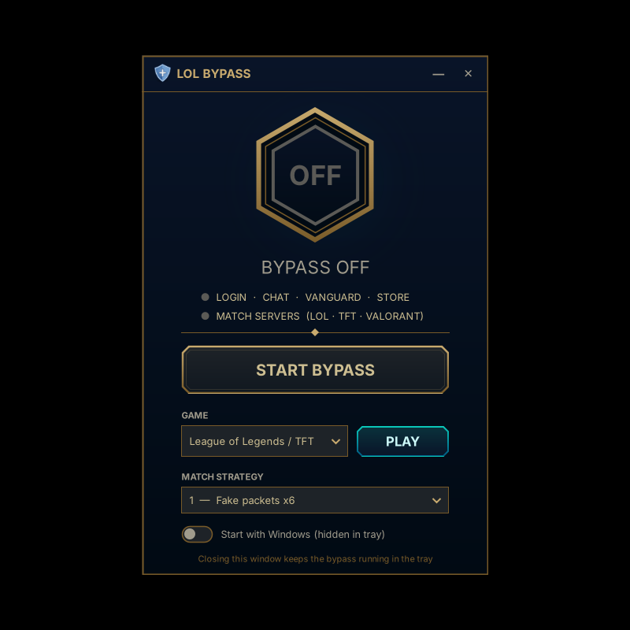

# LoL Bypass

Play **League of Legends, TFT, VALORANT and Legends of Runeterra without a VPN** on ISPs that block Riot with DPI (tested on Egyptian ISPs).
It's a normal Windows app with a Riot-style window. It starts hidden in the tray with Windows, uses no VPN, and adds no extra ping.

> العب ليج أوف ليجندز و TFT و فالورانت و Runeterra من غير VPN على النت المصري. نزّل الـ Setup من صفحة الـ Releases، وثبّته، وخلاص.

<p align="center"></p>

## Download & install

1. Download **`LoLBypass-Setup-x.y.z.exe`** from the [**Releases**](../../releases/latest) page.
2. Run it and click **Yes** on the admin prompt. Keep the default options:
   - **Windows Defender exclusion (recommended).** It's added *before* any file is unpacked, so Defender doesn't delete the bypass files. Nothing to do by hand.
   - **Start with Windows.** Starts the bypass hidden in the tray every time you sign in, with no admin prompt.
   - **Desktop shortcut**
3. Finish. The app opens and the bypass starts.

Requires 64-bit Windows 10 or 11. .NET Framework 4.8 is already built into Windows.

## Use

| | |
|---|---|
| **START / STOP BYPASS** | the big gold button |
| **GAME + PLAY** | pick League / TFT, VALORANT or Runeterra and launch it through the Riot Client |
| **Match strategy 1-4** | if a match won't connect ("Failed to Connect" / reconnect loop), try the next one. Saved automatically |
| **Start with Windows** | turns auto-start on or off |
| **Tray icon** | click to open the window, right-click for Restart, Stop, Log or Exit |

Closing the window keeps the bypass running in the tray. Log: `C:\ProgramData\LoL Bypass\bypass.log`.
Uninstall from **Settings → Apps → LoL Bypass**.

## What it fixes

| Problem (with no VPN) | Cause | Fix |
|---|---|---|
| Can't log in | ISP intercepts TLS to `auth.riotgames.com` (fake certificate) | GoodbyeDPI splits the TLS hello so the DPI can't read the server name |
| Chat offline | Port 5223 is reset | GoodbyeDPI covers 5222/5223 |
| `VAN 84` / "Vanguard session is initializing" | Vanguard (`vgc`) connection on 8443 is cut | GoodbyeDPI covers 8443, and `vgc` is restarted behind the bypass |
| Match won't load / reconnect loop | DPI drops the first UDP packets to the match server | zapret `winws` sends fake packets ahead of the real ones |

```
Riot Client / League / VALORANT
 ├─ TCP 443, 8443, 2099, 5222/5223, 8088, 8393-8400  →  GoodbyeDPI -1   (login, chat, Vanguard, store)
 └─ UDP 5000-9999 → Riot IP ranges (riot-game-ips.txt) →  zapret winws    (LoL / TFT match servers)
    UDP 7000-8999 → any IP                              →  zapret winws    (VALORANT match servers)
```

Tested end to end on League of Legends (EUNE). TFT and Runeterra use the same login, chat and Vanguard path. VALORANT match servers are covered by their own rule; if a VALORANT match won't connect, try another strategy.

## Antivirus notes

- **Windows Defender:** handled by the installer (see above).
- **Other antivirus apps** (Kaspersky, Avast, ESET, ...) may still flag `winws.exe` / `goodbyedpi.exe`, because the WinDivert packet driver they use is a common false positive. Add an exclusion for `C:\Program Files\LoL Bypass` in that antivirus.
- The setup isn't code-signed, so the browser or SmartScreen may warn on download. Choose *Keep* / *More info → Run anyway*.

## Build from source

```bash
./build.sh 1.0.0      # needs .NET SDK 8+ and NSIS 3 (makensis); works on Linux or Windows
```

- `src/LoLBypass/`: the app (C#, WinForms, .NET Framework 4.8)
- `installer/LoLBypass.nsi`: the installer (NSIS)
- `payload/`: bundled GoodbyeDPI and zapret binaries, the Riot IP list and licenses

## Credits & licenses

- [GoodbyeDPI](https://github.com/ValdikSS/GoodbyeDPI) by ValdikSS, Apache-2.0
- [zapret](https://github.com/bol-van/zapret) by bol-van, MIT
- [WinDivert](https://github.com/basil00/WinDivert) by basil00, LGPL-3.0 / GPL-2.0

Bundled binaries are unmodified upstream builds (GoodbyeDPI 0.2.3rc3, zapret-win-bundle). License texts are in `payload/licenses/`.
